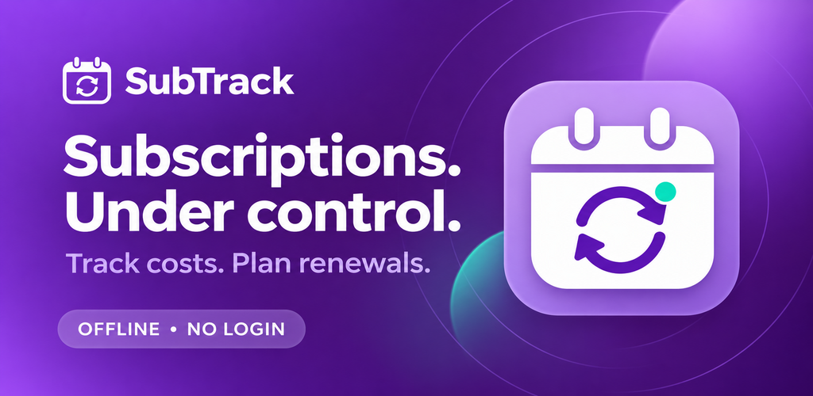
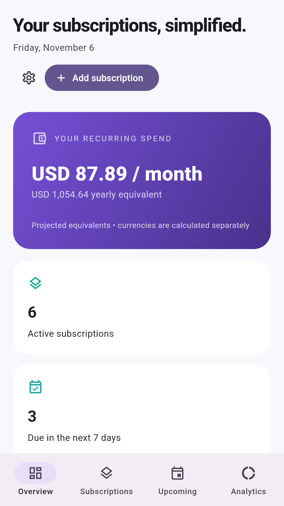
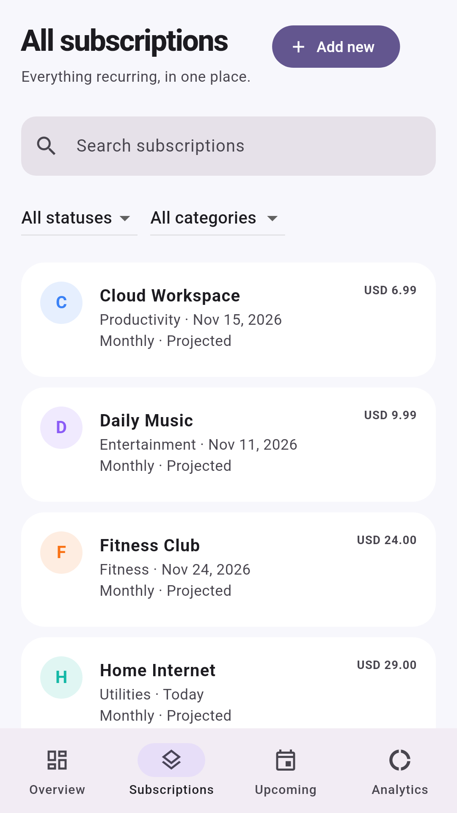
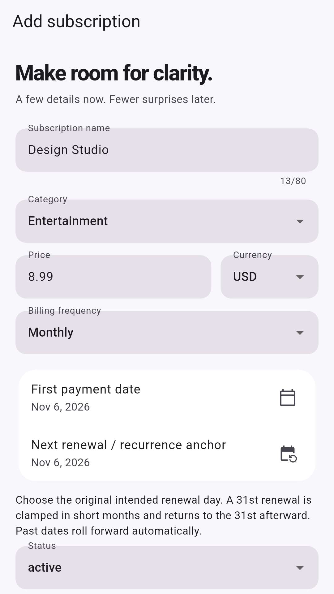
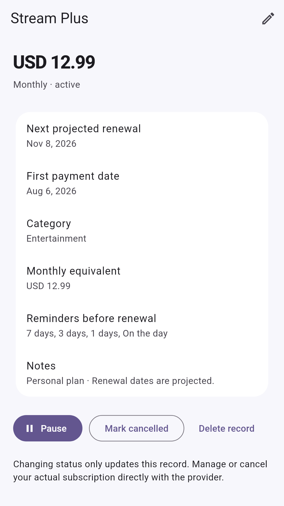
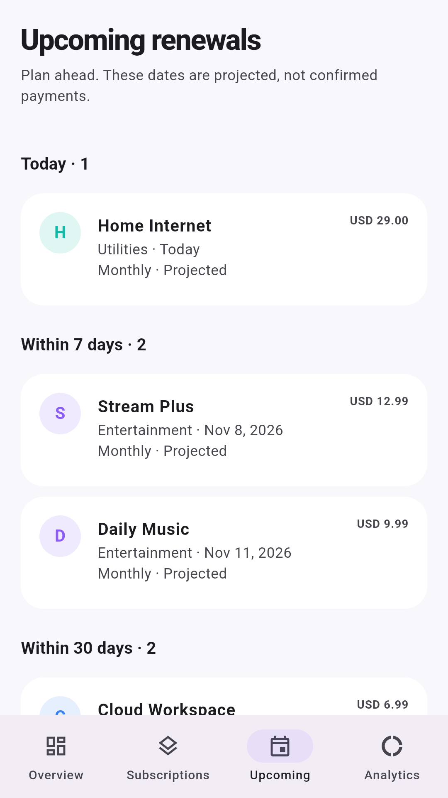
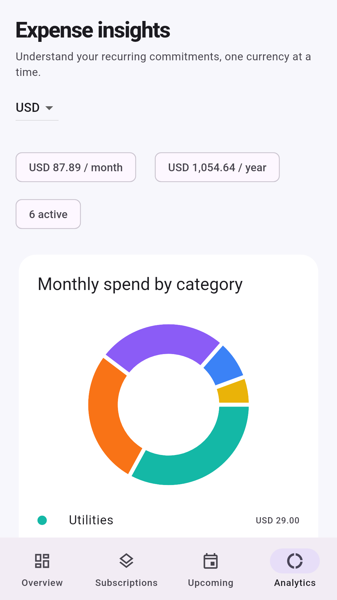
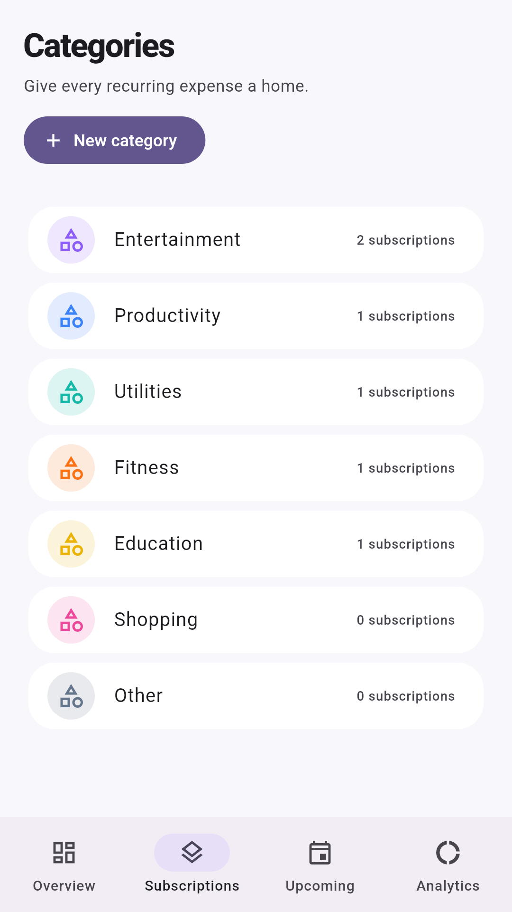
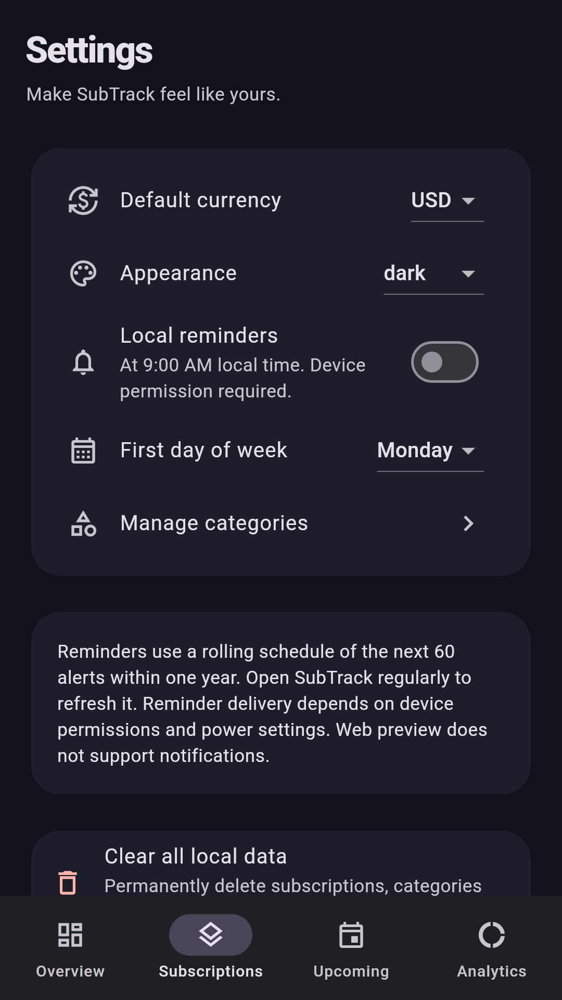

# SubTrack launch assets

[Launch checklist](../docs/release/publishing-checklist.md) · [Store copy](android/en-US) · [Privacy source](../docs/legal/privacy-policy.md)

## Brand

## Eight Android screenshots

   

   

[Eight iPhone screenshots](ios/en-US/screenshots) are also included. Images use real Flutter views and fictional sample records. See provenance and dimensions in [asset inventory](asset-manifest.json).

Temporary support contact remains `support@subtrack.example`. Replace before submitting to a store.
